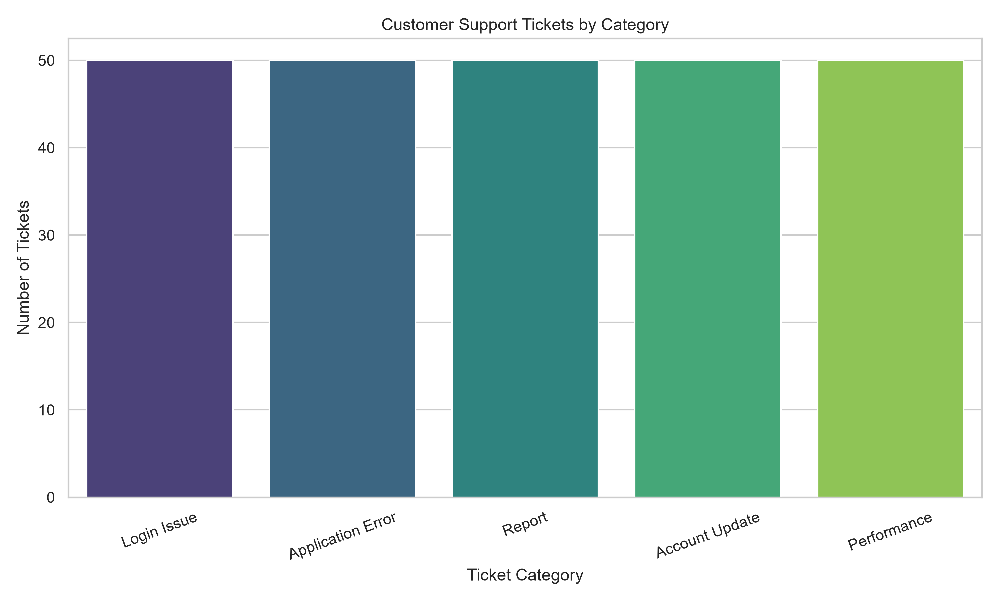
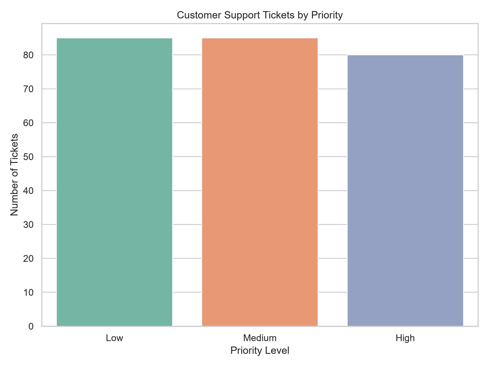
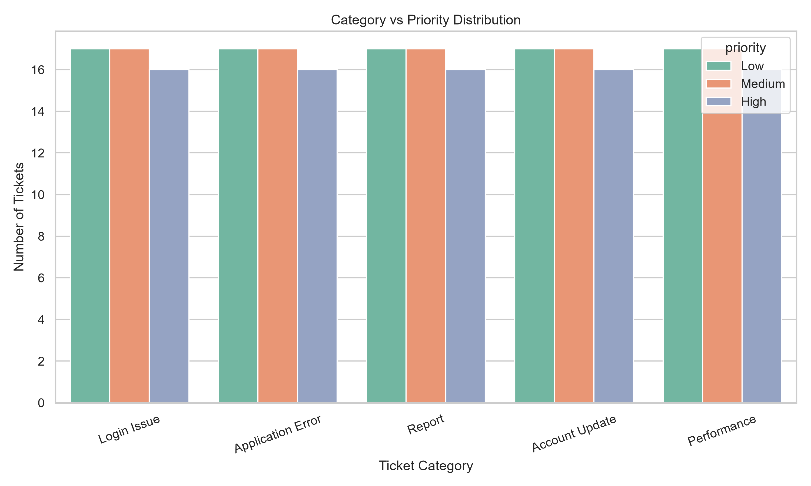
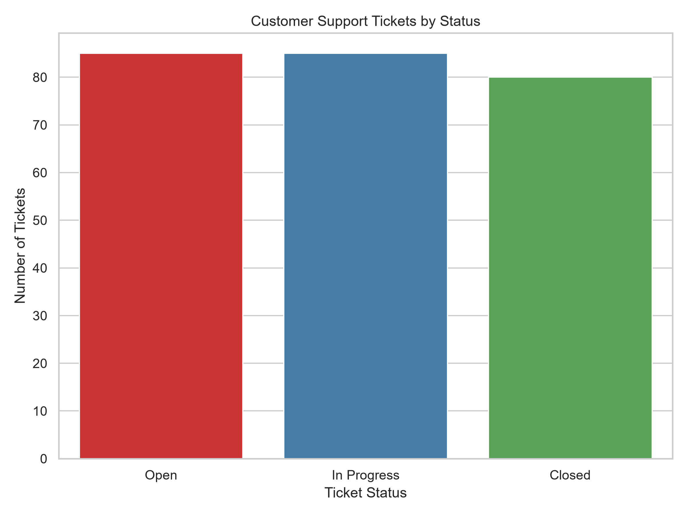
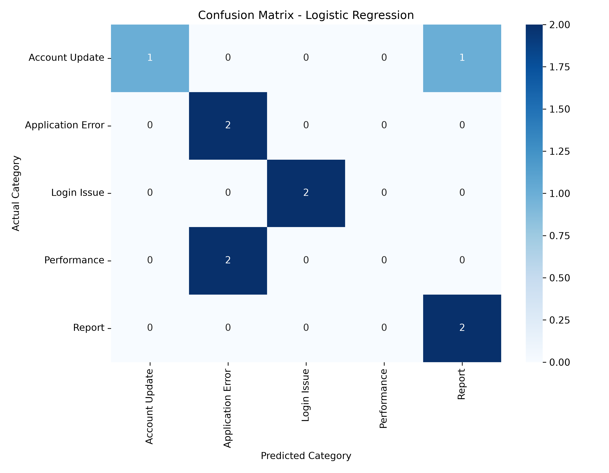

# 🎫 Customer Support Ticket Classification System

### AI/ML-Powered Customer Support Ticket Classification Using NLP and Machine Learning

An intelligent customer support ticket classification application that automatically categorizes customer requests based on their textual descriptions using Natural Language Processing (NLP) and Machine Learning.

Built using Python, TF-IDF, Logistic Regression, Multinomial Naive Bayes and Streamlit, the system predicts ticket categories, displays model confidence scores and provides predefined suggested customer responses.

---

## 📌 Project Overview

Customer support teams receive numerous requests through emails, chats and other communication channels. Manually categorizing these requests can be time-consuming and inefficient.

This project aims to automate the ticket classification process using supervised machine learning techniques.

The application analyzes customer ticket descriptions and predicts the most appropriate category.

## ✨ Key Features

- **Automated Ticket Classification:** Automatically categorizes customer support requests.
- **Text Preprocessing:** Cleans and normalizes ticket descriptions.
- **TF-IDF Vectorization:** Converts textual descriptions into numerical features.
- **Multiple ML Algorithms:** Implements Logistic Regression and Multinomial Naive Bayes.
- **Model Evaluation:** Evaluates models using Accuracy, Precision, Recall, F1-score and Confusion Matrix.
- **Real-Time Prediction:** Classifies newly submitted ticket descriptions.
- **Confidence Score:** Displays the predicted class probability.
- **Suggested Responses:** Provides predefined customer responses based on the predicted category.
- **Interactive Web Interface:** Provides a user-friendly application built with Streamlit.

## 📂 Supported Ticket Categories

The system currently supports five customer support categories:

| Category | Description |
|---|---|
| Login Issue | Problems related to login and password access |
| Application Error | Application crashes and software errors |
| Report | Requests related to reports and data exports |
| Account Update | Changes to registered account information |
| Performance | Slow loading and application performance issues |

## 🛠️ Technology Stack

| Technology | Purpose |
|---|---|
| Python | Core programming language |
| Pandas | Data manipulation |
| NumPy | Numerical operations |
| Matplotlib | Data visualization |
| Seaborn | Statistical visualization |
| Scikit-learn | Machine learning implementation |
| TF-IDF | Text feature extraction |
| Logistic Regression | Classification algorithm |
| Multinomial Naive Bayes | Classification algorithm |
| Streamlit | Web application interface |
| Joblib | Model serialization and loading |

## 📊 Dataset Information

The project uses a synthetically generated customer support ticket dataset.

| Dataset Attribute | Details |
|---|---|
| Initial records | 250 |
| Number of categories | 5 |
| Initial records per category | 50 |
| Unique descriptions after deduplication | 50 |
| Training records | 40 |
| Testing records | 10 |
| Dataset format | CSV |

### Dataset Features

- `ticket_id` – Unique ticket identifier.
- `ticket_description` – Customer support issue description.
- `category` – Target classification category.
- `priority` – Ticket priority.
- `status` – Current ticket status.

**Note:** The dataset is synthetically generated for this project and does not contain real customer information.

## ⚙️ Machine Learning Workflow

The project follows the following machine learning pipeline:

1. Dataset Collection and Generation
2. Data Preprocessing and Cleaning
3. Exploratory Data Analysis (EDA)
4. TF-IDF Feature Extraction
5. Machine Learning Model Training
6. Model Evaluation and Comparison
7. New Ticket Prediction
8. Streamlit Web Application Deployment

### Algorithms Implemented

**1. Logistic Regression**

A supervised classification algorithm that estimates class probabilities and predicts the most likely ticket category.

**2. Multinomial Naive Bayes**

A probabilistic classification algorithm based on Bayes' theorem, commonly used for text classification tasks.

Both algorithms are implemented using Scikit-learn Pipelines with TF-IDF vectorization.

## 📈 Model Performance

Both machine learning algorithms were evaluated using a stratified 80:20 train-test split.

### Evaluation Results

| Evaluation Metric | Logistic Regression | Naive Bayes |
|---|---:|---:|
| Accuracy | 70.00% | 70.00% |
| Precision (Macro) | 63.33% | 63.33% |
| Recall (Macro) | 70.00% | 70.00% |
| F1-score (Macro) | 65.67% | 65.67% |

Both algorithms achieved identical aggregate evaluation results on the held-out test dataset.

**Important:** These are preliminary results based on only 50 unique descriptions and 10 testing records. They should not be interpreted as representative of real-world performance.

## 🖥️ Application Screenshots

### Exploratory Data Analysis

**Category Distribution**



**Priority Distribution**



**Category vs Priority**



**Status Distribution**



### Model Evaluation

**Confusion Matrix**



### Web Application

Run the Streamlit application to interact with the ticket classification system.

## 🚀 Installation and Setup

Follow these steps to run the project locally.

### 1. Clone the Repository

```bash
git clone https://github.com/ayan2dj/Customer-Support-Ticket-Classification-System.git
```

### 2. Navigate to the Project Directory

```bash
cd Customer-Support-Ticket-Classification-System
```

### 3. Create a Virtual Environment

```bash
python -m venv venv
```

Activate the virtual environment on Windows:

```bash
venv\Scripts\activate
```

### 4. Install Dependencies

Make sure the dependency file is named `requirements.txt`.

```bash
pip install -r requirements.txt
```

### 5. Run Data Preprocessing

```bash
python preprocessing.py
```

### 6. Perform Exploratory Data Analysis

```bash
python eda.py
```

### 7. Train and Evaluate the Models

```bash
python train.py
```

This step trains both algorithms, compares their performance and saves the selected model.

### 8. Test New Predictions

```bash
python test_predictions.py
```

### 9. Launch the Web Application

```bash
streamlit run app.py
```

Open the local application in your browser:

```text
http://localhost:8501
```

## 🧪 Sample Prediction

**Sample Input:**

```text
I cannot log in to my account because
my password reset is not working.
```

**Expected Output:**

```text
Predicted Category: Login Issue

Model Confidence: Model-dependent

Suggested Response:

Please use the Forgot Password option
on the login page to reset your password.
If the problem continues, contact our
support team.
```

### Additional Prediction Testing

Five new ticket descriptions were tested after model training.

| Test Case | Predicted Category | Confidence |
|---|---|---:|
| Sign-in credentials not accepted | Login Issue | 22.63% |
| Software crashes in settings | Application Error | 27.88% |
| Export last month's revenue | Report | 25.74% |
| Change registered email | Account Update | 30.18% |
| Dashboard responds slowly | Performance | 26.71% |

All five predictions matched their expected categories.

The confidence values represent the model's estimated class probabilities and are not guarantees of prediction correctness.

## 📁 Project Structure

```text
Customer-Support-Ticket-Classification-System/
│
├── data/
│   ├── tickets.csv
│   └── cleaned_tickets.csv
│
├── src/
│   ├── __init__.py
│   ├── preprocessing.py
│   ├── eda.py
│   ├── model.py
│   ├── train.py
│   ├── predict.py
│   └── app.py
│
├── model/
│   ├── ticket_classifier.pkl
│   ├── best_model.txt
│   └── model_comparison.csv
│
├── screenshots/
│   ├── category_distribution.png
│   ├── category_vs_priority.png
│   ├── confusion_matrix.png
│   ├── priority_distribution.png
│   └── status_distribution.png
│
├── requirements.txt
├── README.md
├── report.pdf
├── .gitignore
└── test_predictions.py
```

*The structure above represents the recommended organization of the project files.*

## ⚠️ Limitations

- The dataset is synthetically generated.
- Only 50 unique descriptions remain after duplicate removal.
- The testing dataset contains only 10 records.
- Only five predefined ticket categories are supported.
- The model's probability estimates have not been calibrated.
- Suggested responses are predefined rule-based messages.

## 🔮 Future Enhancements

- Expand the dataset with diverse real-world customer support examples.
- Introduce additional ticket categories.
- Experiment with advanced NLP and deep-learning models.
- Improve classification performance through cross-validation and hyperparameter tuning.
- Integrate a database for ticket management.
- Develop a REST API for external integration.
- Introduce human feedback for continuous model improvement.
- Integrate Large Language Models for more flexible customer responses.

## 🎯 Project Objective

The primary objective of this project is to demonstrate how Natural Language Processing and supervised machine learning can automate customer support ticket categorization and assist support teams in managing incoming customer requests more efficiently.

## 👨‍💻 Author

**Ayan Das**

B.Tech – Computer Science and Engineering

GitHub: [ayan2dj](https://github.com/ayan2dj)

LinkedIn: [Ayan Das](https://www.linkedin.com/in/ayan-das-470835268/)

## 📄 Technical Documentation

Refer to the project technical report for detailed information about dataset preparation, preprocessing, model implementation, evaluation results, limitations and future improvements.

## 🤖 AI Tools Disclosure

AI tools were used for conceptual explanations, debugging assistance, implementation guidance and documentation preparation. The implementation and results were reviewed during project development.

---

**If you find this project useful, consider giving the repository a ⭐!**
